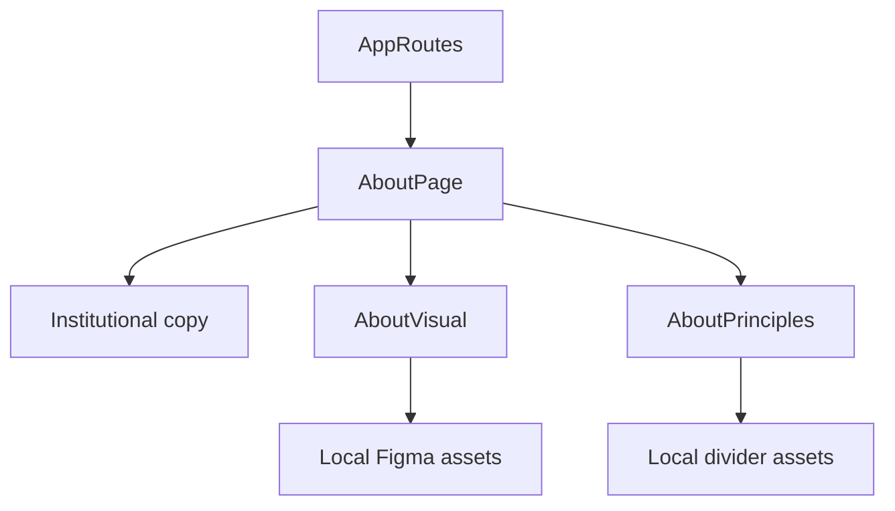

# Tela Sobre Civix — Design

> **Auditoria de estado — 2026-10-10:** este documento preserva decisões, checkboxes e resultados históricos. A vigência dos requisitos antigos está **Aguardando resposta**. Não restaurar layout, reabrir escopo ou declarar gates atuais aprovados sem confirmação e evidência.
> AppRoute não registra /sobre; About aparece dentro da Home. dashboard.png e macbook-silver.png do manifest histórico não existem no checkout; AboutVisual usa macbook.png e não renderiza dashboard. Não foi decidido restaurar a composição original ou aceitar essas divergências.
> Revisão consolidada: [pendências das specs](../../reviews/revisao-pendencias-specs.md).

**Spec**: `.specs/features/about-page/spec.md`
**Status**: Approved

---

## Architecture Overview

A rota `/sobre` renderizará um `AboutPage` estático. A página compõe dois componentes de apresentação: `AboutVisual`, responsável pelo notebook e ornamentos, e `AboutPrinciples`, responsável por Valor, Visão e Missão. Tailwind 4 traduz a geometria absoluta do desktop para uma grade responsiva em viewports menores. Todos os assets são imports locais.



### Abordagens avaliadas

| Approach | Vantagens | Limitações | Decision |
| --- | --- | --- | --- |
| Página React com subcomponentes e Tailwind responsivo | Preserva semântica, facilita testes e mantém fidelidade desktop | Requer tradução cuidadosa das coordenadas | **Escolhida** |
| Um único componente totalmente absoluto | Rápido para desktop | Frágil em mobile e difícil de testar | Rejeitada |
| Imagem única da tela inteira | Paridade visual imediata | Conteúdo inacessível, não responsivo e pesado | Rejeitada |

---

## Figma Translation

### Desktop de referência

| Element | Figma geometry | Translation |
| --- | --- | --- |
| Frame | `1728 × 760` | `main` com altura mínima de `760 px` e fundo ivory |
| Marcador | `x 128`, `y 80`, `88 × 19` | Posição absoluta no desktop; fluxo no mobile |
| Título | `x 813`, `y 80`, `683 × 105` | Urbanist `48 px`, largura máxima `683 px` |
| Introdução | `x 813`, `y 209`, `557 px` | Inter `16 px`, navy a 80% |
| Notebook | grupo a partir de `x 128`, `y 247` | Container de `635 × 477 px`, rotação aproximada de `6.8°` |
| Destaque | `x 672`, `y 289`, `104 × 104` | SVG decorativo absoluto |
| Princípios | `x 989–1600`, `y 446–730` | Três linhas alinhadas; stack em mobile |
| Forma de fundo | parcial em `x -165`, base da tela | SVG decorativo recortado pelo frame |

### Responsive behavior

| Range | Copy | Visual | Principles |
| --- | --- | --- | --- |
| `≥1024 px` | Geometria absoluta proporcional ao frame | Notebook composto e rotacionado à esquerda | Lista alinhada à direita |
| `768–1023 px` | Duas colunas para título e introdução | Visual centralizado abaixo | Lista em largura total |
| `<768 px` | Marcador, título e introdução empilhados | Notebook reduzido, sem invadir o texto | Cards lineares com descrição abaixo do título |

---

## Code Reuse Analysis

### Existing Components to Leverage

| Component / pattern | Location | How to Use |
| --- | --- | --- |
| App router | `src/routes/AppRoute.tsx` | Registrar `/sobre` sem alterar outras rotas. |
| Civix tokens | `src/index.css` | Reutilizar navy, gold, ivory, Urbanist e Inter. |
| Alias `@` | `vite.config.ts` | Manter imports absolutos consistentes. |
| RTL/Vitest | `vite.config.ts`, `src/test/setup.ts` | Testar conteúdo, semântica e rota. |

### Integration Points

| System | Integration Method |
| --- | --- |
| Figma | Contexto e exports do frame `103:1987` |
| React Router | Rota pública `/sobre` |
| Assets | Imports estáticos processados pelo Vite |
| Validação visual | Servidor Vite local em quatro viewports |

---

## Components

### AboutVisual

- **Purpose**: Compor dashboard, notebook, anel de fundo e destaque gráfico.
- **Location**: `src/components/about/AboutVisual.tsx`
- **Interfaces**: componente de apresentação sem props.
- **Dependencies**: quatro assets locais do Figma.
- **Reuses**: tokens e regras responsivas Tailwind já existentes.

### AboutPrinciples

- **Purpose**: Renderizar Valor, Visão e Missão com seus divisores e descrições.
- **Location**: `src/components/about/AboutPrinciples.tsx`
- **Interfaces**: componente de apresentação sem props; dados internos imutáveis.
- **Dependencies**: dois divisores SVG locais.
- **Reuses**: Urbanist e Inter auto-hospedadas.

### AboutPage

- **Purpose**: Compor a tela institucional e sua hierarquia semântica.
- **Location**: `src/pages/About.tsx`
- **Interfaces**: página sem props.
- **Dependencies**: `AboutVisual` e `AboutPrinciples`.
- **Reuses**: fundo e tokens globais Civix.

---

## Data Models

### AboutPrinciple

```typescript
interface AboutPrinciple {
  title: 'Valor' | 'Visão' | 'Missão'
  description: string
  divider?: string
}
```

O modelo é local e somente organiza conteúdo estático.

---

## Asset Manifest

| Local asset | Figma usage |
| --- | --- |
| `src/assets/civix/about/dashboard.png` | Interface exibida na tela do notebook |
| `src/assets/civix/about/macbook-silver.png` | Moldura física do notebook |
| `src/assets/civix/about/background-shape.svg` | Anel dourado inferior esquerdo |
| `src/assets/civix/about/value-divider.svg` | Divisor de Valor |
| `src/assets/civix/about/vision-divider.svg` | Divisor de Visão |
| `src/assets/civix/about/emphasis-scribble.svg` | Destaque ao lado do notebook |

---

## Error Handling Strategy

| Error Scenario | Handling | User Impact |
| --- | --- | --- |
| Figma indisponível em runtime | Assets versionados e empacotados localmente | Nenhum impacto |
| Fonte ainda não carregada | Fallback sans-serif existente | Conteúdo permanece visível |
| Viewport estreito | Fluxo vertical e imagens limitadas a `max-width: 100%` | Sem corte horizontal |

---

## Risks & Concerns

| Concern | Location (file:line) | Impact | Mitigation |
| --- | --- | --- | --- |
| O branch inicia com build quebrado por tipo antigo no teste do header | `src/components/layout/SiteHeader.test.tsx:95` | Bloqueia o gate completo | Atualizar somente o destino de teste para o contrato de rota atual. |
| Fast Refresh reprova export auxiliar não utilizado | `src/components/ui/button.tsx:58` | Bloqueia lint | Remover o export público não consumido; manter uso interno. |
| Testes concorrentes expiraram ao iniciar workers | `vite.config.ts:13` | Pode gerar falso negativo ambiental | Reexecutar Vitest isoladamente antes de alterar configuração. |
| Asset do notebook tem `7.8 MB` | `src/assets/civix/about/macbook-silver.png` | Aumenta o bundle e pode afetar LCP | Manter bytes originais nesta entrega por fidelidade; registrar otimização como follow-up. |
| O frame não contém header/footer | Figma `103:1987` | Adicionar chrome quebraria paridade | Renderizar somente o conteúdo do frame na rota. |

---

## Tech Decisions

| Decision | Choice | Rationale |
| --- | --- | --- |
| Estrutura | Página + dois componentes de apresentação | Separa visual complexo, conteúdo institucional e integração. |
| Desktop | Coordenadas controladas em frame máximo de `1728 px` | Permite comparação objetiva ao Figma. |
| Mobile | Fluxo vertical derivado | Mantém ordem de leitura e evita sobreposição. |
| Assets | Exports originais locais | Evita URLs temporárias e placeholders. |
| Chrome global | Ausente nesta rota | O frame é a fonte visual correta. |
