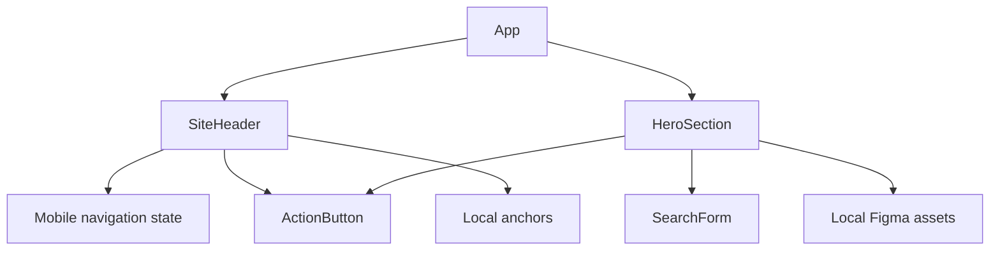

# Hero da Home Civix — Design

> **Auditoria de estado — 2026-10-10:** este documento preserva decisões, checkboxes e resultados históricos. A vigência dos requisitos antigos está **Aguardando resposta**. Não restaurar layout, reabrir escopo ou declarar gates atuais aprovados sem confirmação e evidência.
> Componentes atuais estão em src/components/home. Home incorpora About com outro main/h1; header usa destinos de aplicação, incluindo /planos sem rota registrada. As verificações originais de âncoras locais, semântica única e geometria não constituem validação atual.
> Revisão consolidada: [pendências das specs](../../reviews/revisao-pendencias-specs.md).

**Spec**: `.specs/features/home-hero/spec.md`
**Status**: Approved

---

## Architecture Overview

A home continuará com um único ponto de entrada em `App.tsx`, que compõe componentes de apresentação por responsabilidade. Tailwind 4 controlará layout e responsividade; `index.css` concentrará tokens, fontes e estilos globais. Os assets serão cópias locais dos exports do Figma para evitar URLs temporárias em produção.



### Abordagens avaliadas

| Approach | Vantagens | Limitações | Decision |
| --- | --- | --- | --- |
| Componentes React + Tailwind + tokens CSS | Reuso, responsividade clara, testes por comportamento e aderência à stack | Exige traduzir coordenadas absolutas do Figma para layout fluido | **Escolhida pelo usuário** |
| Um componente com posicionamento absoluto | Reprodução desktop rápida | Frágil em tablet/mobile e difícil de manter | Rejeitada |
| Componentes React + CSS global | Semântica adequada e controle visual | Ignora a configuração Tailwind já adicionada | Rejeitada |

---

## Figma Translation

### Desktop de referência

| Element | Figma geometry | Translation |
| --- | --- | --- |
| Frame | `1728 × 1117` | `main` com fundo ivory e largura total |
| Header logo | `x 128`, `y 32`, `99 × 32` | Container central com padding lateral de `128 px` no viewport de referência |
| Navegação | `x 1138`, `y 39`, `306 × 19` | Lista horizontal com quatro âncoras e gap equivalente |
| CTA do header | `x 1462`, `y 28`, `138 × 42` | Variante primary de `ActionButton` |
| Hero container | `x 64`, `y 109`, `1600 × 900` | `max-width: 1600px`, raio `24 px`, overflow oculto |
| Copy da hero | Offset `63 × 124` dentro do container | Bloco com largura máxima de `643 px` |
| Busca | `x 350`, `y 920`, `1104 × 142` | Card sobreposto no desktop e em fluxo no mobile |

### Responsive behavior

| Range | Header | Hero | Search |
| --- | --- | --- | --- |
| `≥1024 px` | Logo, âncoras e CTA visíveis | Layout desktop fluido até `1600 px` | Card horizontal sobreposto |
| `768–1023 px` | Botão de menu e painel compacto | Copy reduzida e ilustração recortada à direita | Grade de duas colunas, botão ocupando coluna final |
| `<768 px` | Botão de menu com painel vertical | Conteúdo empilhado, CTAs com wrap, ilustração reposicionada | Campos e botão empilhados em largura total |

### Typography

| Role | Family | Weight | Desktop size / line height |
| --- | --- | --- | --- |
| Hero title | Urbanist Variable | 600 | `64 / 80 px` |
| Body copy | Inter Variable | 400 | `18 px / normal` |
| Buttons | Urbanist Variable | 600 | `18 / 19.8 px` |
| Navigation | Inter Variable | 400 | `16 px / normal` |
| Form fields | Urbanist Variable | 500 | `16 / 24 px` |

As fontes serão auto-hospedadas pelos pacotes `@fontsource-variable/urbanist` e `@fontsource-variable/inter`, importando somente o eixo `wght`. O Vite emitirá os arquivos como assets versionados do bundle.

### Design tokens

```css
:root {
  --color-civix-navy: #07192a;
  --color-civix-gold: #d89c28;
  --color-civix-ivory: #faf9f6;
  --color-civix-ink: #0e0e10;
  --font-display: 'Urbanist Variable', sans-serif;
  --font-body: 'Inter Variable', sans-serif;
  --radius-control: 8px;
  --radius-hero: 24px;
  --radius-search: 16.8px;
}
```

---

## Code Reuse Analysis

### Existing Components to Leverage

| Component / pattern | Location | How to Use |
| --- | --- | --- |
| React application entry | `src/main.tsx` | Manter `StrictMode` e a montagem existente. |
| App entry component | `src/App.tsx` | Substituir somente o conteúdo do template pela composição da home. |
| Tailwind Vite plugin | `vite.config.ts` | Reutilizar a integração Tailwind 4 já adicionada nas alterações locais. |
| Global stylesheet entry | `src/index.css` | Substituir tokens do template por tokens Civix e manter o único import ativo do Tailwind. |
| Alias `@` | `vite.config.ts` | Usar imports consistentes a partir de `src`. |

Não há componentes shadcn/ui, `components.json` ou design system implementado. Esta feature criará somente os primitivos necessários; a instalação completa do shadcn fica fora do escopo.

### Integration Points

| System | Integration Method |
| --- | --- |
| Figma | `get_design_context`, screenshot e download dos assets do frame `90:1204` |
| Navegação | Âncoras HTML locais; nenhuma biblioteca de roteamento |
| Pesquisa | Estado React local e `preventDefault`; nenhuma API |
| Testes | Vitest em ambiente jsdom com React Testing Library |
| Validação visual | Servidor Vite local e capturas nos viewports definidos na spec |

---

## Components

### ActionButton

- **Purpose**: Padronizar CTAs primary, light e translucent com o ícone de seta exportado.
- **Location**: `src/components/ui/ActionButton.tsx`
- **Interfaces**:
  - `ActionButtonProps extends React.AnchorHTMLAttributes<HTMLAnchorElement>`
  - `variant: 'primary' | 'light' | 'translucent'`
  - `showArrow?: boolean`
- **Dependencies**: Tailwind, asset `arrow-right.svg`.
- **Reuses**: Padrão visual dos instances `Link - Button` do Figma.

### SiteHeader

- **Purpose**: Exibir logo, navegação desktop, CTA e menu compacto derivado.
- **Location**: `src/components/layout/SiteHeader.tsx`
- **Interfaces**:
  - `navigationItems?: readonly NavigationItem[]`
- **Dependencies**: `ActionButton`, logo local e estado React do menu.
- **Reuses**: Âncoras do instance `Navbar - Ancoras`.
- **Behavior**: `aria-expanded`, `aria-controls`, fechamento por `Escape` e por seleção de âncora, restauração de foco.

### SearchForm

- **Purpose**: Representar os três filtros do Figma com semântica de formulário e estado local.
- **Location**: `src/components/home/SearchForm.tsx`
- **Interfaces**:
  - `initialValues?: Partial<SearchFormValues>`
  - `onSubmit?: (values: SearchFormValues) => void`
- **Dependencies**: React state, asset de seta e indicador do seletor.
- **Reuses**: Geometria e conteúdo do frame `Search`.
- **Behavior**: campos opcionais, textos limitados a 100 caracteres e submit sem efeitos externos por padrão.

### HeroSection

- **Purpose**: Compor copy, CTAs, ilustração e `SearchForm` dentro do container responsivo.
- **Location**: `src/components/home/HeroSection.tsx`
- **Interfaces**: componente de apresentação sem props nesta feature.
- **Dependencies**: `ActionButton`, `SearchForm` e assets locais.
- **Reuses**: Tokens globais e conteúdo do frame `90:1204`.

### App

- **Purpose**: Compor os landmarks da primeira tela da home.
- **Location**: `src/App.tsx`
- **Interfaces**: componente raiz sem props.
- **Dependencies**: `SiteHeader` e `HeroSection`.
- **Reuses**: Entrada existente em `main.tsx`.

---

## Data Models

### NavigationItem

```typescript
interface NavigationItem {
  label: string
  href: `#${string}`
}
```

### SearchFormValues

```typescript
interface SearchFormValues {
  query: string
  region: string
  priceRange: '' | 'ate-1000' | '1000-5000' | 'acima-5000'
}
```

Os valores são apenas de apresentação e não constituem contrato futuro de API.

---

## Asset Manifest

| Local asset | Figma source | Usage |
| --- | --- | --- |
| `src/assets/civix/logo-civix.png` | node `90:1239` | Logo do header |
| `src/assets/civix/hero-artwork.svg` | node `90:1279` | Fundo vetorial principal |
| `src/assets/civix/decorative-shape.svg` | node `85:1000` | Forma decorativa superior |
| `src/assets/civix/arrow-right.svg` | node `90:1254` | CTAs e pesquisa |
| `src/assets/civix/select-chevron.svg` | node `90:1232` | Indicador de faixa de preço |

Cada arquivo será baixado do Figma durante a execução. URLs MCP temporárias não serão persistidas no código.

---

## Error Handling Strategy

| Error Scenario | Handling | User Impact |
| --- | --- | --- |
| Submit sem backend | `preventDefault` e callback local opcional | Nenhuma navegação ou mensagem enganosa |
| Texto maior que 100 caracteres | `maxLength={100}` | Caracteres excedentes não são inseridos |
| Fonte ainda não carregada | Fallback sans-serif e `font-display: swap` | Conteúdo permanece visível |
| Asset temporário indisponível durante implementação | Reexecutar download pelo Figma antes de codificar | Nenhuma URL temporária chega à build final |

---

## Accessibility and Interaction States

- `header`, `nav`, `main`, `section` e `form` serão elementos semânticos.
- O menu mobile terá nome acessível, `aria-expanded` e gerenciamento previsível de foco.
- Campos terão `label` associado; placeholders não serão usados como único nome.
- Ilustrações decorativas usarão `alt=""` e `aria-hidden` quando aplicável.
- Hover e active alterarão contraste sem deslocar layout.
- Focus-visible usará outline de pelo menos `2 px` e offset de `2 px`.
- Controles manterão área interativa mínima de `44 × 44 px` nos breakpoints derivados.
- O estado disabled não será usado porque nenhum controle depende de operação assíncrona.

---

## SEO

- Manter `lang="pt-BR"`.
- Definir `<title>Civix</title>`.
- Adicionar meta description curta sobre conexão de clientes, serviços e empresas.
- Manter um único `h1` com a proposta principal.
- Não adicionar Open Graph, schema.org ou sitemap nesta feature.

---

## Risks & Concerns

| Concern | Location (file:line) | Impact | Mitigation |
| --- | --- | --- | --- |
| A aplicação ainda é o template do Vite | `src/App.tsx:1` | Não existe estrutura reutilizável de produto | Substituir de forma cirúrgica e introduzir componentes pequenos. |
| Tokens e dark mode do template conflitam com o Figma | `src/index.css:3` | Cores podem mudar conforme o sistema e quebrar fidelidade | Trocar pelos tokens Civix e fixar a paleta clara nesta feature. |
| Tailwind é importado também em stylesheet do template | `src/App.css:1` | Import duplicado se o arquivo continuar ativo | Remover o import de `App.css` da árvore da aplicação; não alterar o arquivo sem necessidade. |
| Não há testes existentes | `package.json:6` | Regressões de semântica e interação não têm gate | Configurar Vitest, jsdom e React Testing Library antes dos componentes. |
| Não há frames responsivos da hero | Figma `90:1204` | Adaptação pode divergir de uma futura decisão de design | Aplicar breakpoints documentados e validar em cinco viewports. |
| URLs de assets do MCP expiram | Figma MCP | Assets podem quebrar depois de sete dias | Baixar e versionar bytes originais durante T3. |
| Existem alterações locais preexistentes | Git working tree | Uma sobrescrita pode apagar trabalho do usuário | Preservar diffs e editar apenas trechos necessários com patches. |

---

## Tech Decisions

| Decision | Choice | Rationale |
| --- | --- | --- |
| Arquitetura visual | Componentes React + Tailwind + tokens CSS | Opção aprovada e melhor equilíbrio entre fidelidade, reuso e responsividade. |
| Tipografia | Fontsource variable auto-hospedado | Garante pesos do Figma sem CDN em runtime. |
| Assets | Exports originais locais | URLs MCP são temporárias e placeholders não preservam fidelidade. |
| Pesquisa | Estado local sem integração | Backend e resultados estão fora do escopo. |
| Testes | Vitest + React Testing Library + validação visual | Estratégia aprovada para comportamento e fidelidade. |
| shadcn/ui | Não instalar nesta feature | Não existe instalação atual e os quatro componentes necessários são específicos do frame. |
